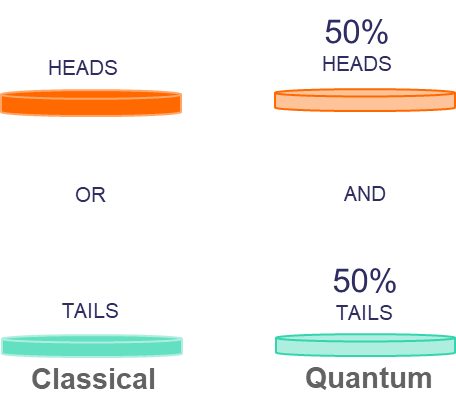

# Quantum Computing And Limitation

## Qubit
Quantum Computer store information in `Quantum Bit (Qubit)` and perform computation based on `Quantum Mechanics`: `Quantum Superposition` and `Quantum Entanglement`. Instead of 0 and 1, we use $\ket{0}$ and $\ket{1}$ to represent Qubit. We will give more details in later sections.

## Superposition
Qubit can be `Linear Combination`(will explain in Linear Algebra module) of $\ket{0}$ and $\ket{1}$, it will `collapse` to either 0 or 1 during `measurement`. Imagine you toss a coin, classical computer only perform calculation when the coin either be head or tail, but quantum computer can perform calculation when the coin is flipping in the air(before drop on table). During the coin drop on the table, either head or tail faced on top, which mean the `Linear Combination` is no longer exists.

[1]

## Entanglement [2]
Entanglement is an unbreakable corelation between 2 or more(can be millions) quantum states.

Let H represent head of coin, T represent tail of coin. Now we have 2 identical coins and 2 magic boxes, put each coin in the box. When the box is closed, the coin will start to spin until someone open(measure) the box. If our 'system' only include 1 box, the quantum state of the closed box will be $\ket{\psi} = \alpha\ket{H} + \beta\ket{T}$, which is in superposition. Now our 'system' include 2 box, and there are unbreakable corelation between 2 boxes even you separate boxes with long distance.

The unbreakable correlations:
- When both boxes are open from top, coin in each box either (H, H) or (T, T)
- When 1 boxes open from top, another box opened from side, the system will either (H, (H or T)) or (T, (H or T)) or (H, T)
- When both boxes are open from side, the coins become (T, T)

> We will discuss it more accurately in Introduction to Quantum Information section

## References
1. [UK National Quantum Computing Centre~Quantum Features](https://www.nqcc.ac.uk/quantum-features/)
2. [Caltech Science Exchange~What Is Entanglement and Why Is It Important?](https://scienceexchange.caltech.edu/topics/quantum-science-explained/entanglement)