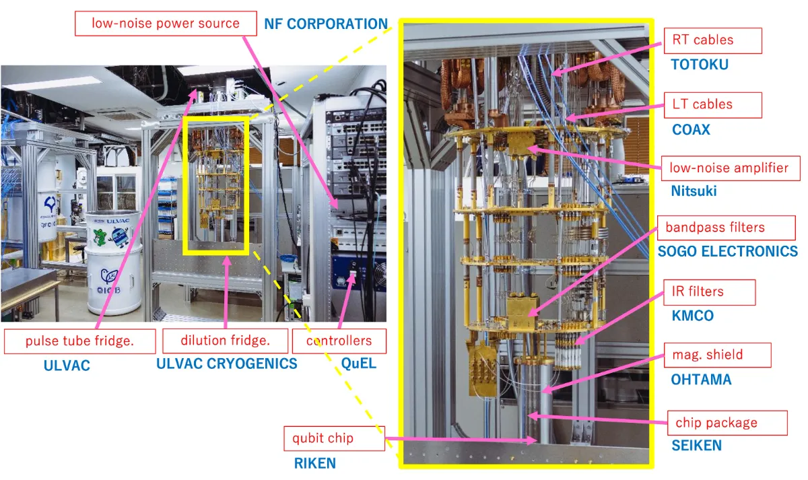
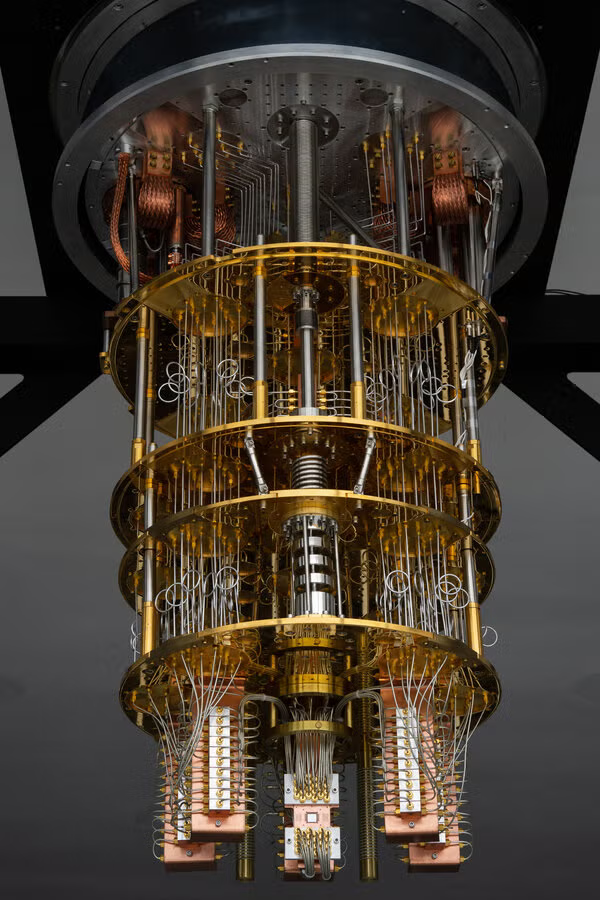

# Overview

> Left image source:https://www.japantimes.co.jp/news/2017/06/16/business/tech/quantum-computing-machines-tomorrow/

We will split whole computers into 3 sections: 
- Quantum Processing Unit (the superconducting chip)
- Controller & Readout device
- Cooling System