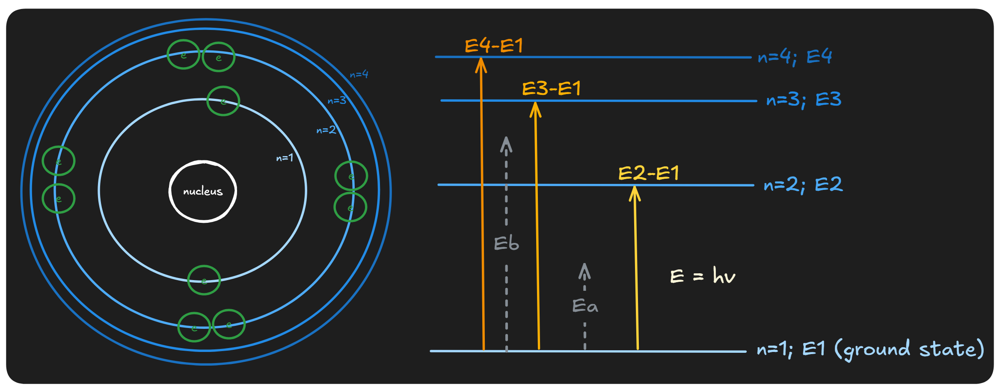
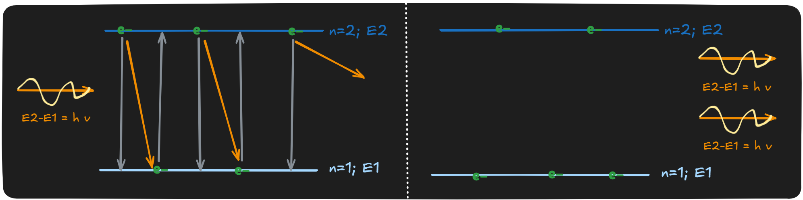

# Quantum Processing Unit
The whole idea is made an artificial atom.

## Review on Natural Atom: Bohr's Model

The electrons are orbiting the nucleus, and carrying different amount of energy in each level. Electron from ground state can promote to excited state when specific amount of energy ($\Delta E$) is transferred to it. Generally, we shoot a photon(electromagnetic wave) with frequency of $\nu$ to system, because $\Delta E = h \nu$. Which means $\Delta E$ must exactly be $E_{target} - E_{current}$. So, the photon with $E_{a}$ or $E_{b}$ not able to excite electron from n1 to any state(level). On the other hand, when electron relax from excited state to ground state, it will emit photon(electromagnetic wave) with frequency of $\nu$, which carrying $| \Delta E|$.

> **Example:**
> 
> In this 2 state case, the emission and absorption both can happen. Another possible outcome of this event maybe: one electron from n1 absorb the photon, then promoted to n2 and no extra photon emitted. 

## Review on Harmonic Oscillation

## Review on Classical LC circuit